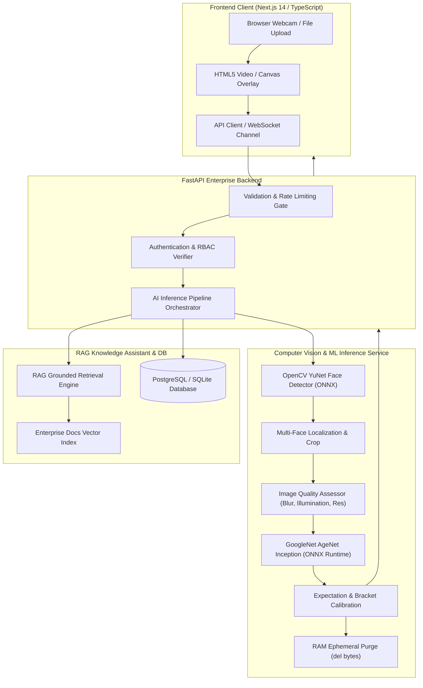

# AI VISION – Enterprise AI Face Detection, Age & Gender Classification Platform

[](#)
[](#)
[](#)
[](#)
[-10B981.svg)](#)
[](#)
[](#)

---

## 1. Executive Summary & Capabilities

**AI VISION** is a production-grade, enterprise AI computer vision SaaS platform engineered for real-time webcam face localization, high-throughput image file analysis, approximate biological age estimation and gender classification using pretrained ONNX deep neural networks, and RAG-powered architectural knowledge assistance.

### Primary Objectives & Ethical Boundaries
- **Zero Facial Identity Matching**: The platform explicitly evaluates morphological age brackets. It **never** identifies individuals, matches against mugshot/citizen galleries, or establishes facial identities.
- **Zero Persistent Biometric Storage**: All incoming camera frames and uploaded images are processed ephemerally in RAM and purged from memory immediately post-inference. No raw images or facial embedding vectors are ever written to disk.
- **Uncertainty Calibration**: Model predictions are presented with entropy-derived uncertainty intervals. Unreliable frames (severe blur, poor lighting, low resolution) are flagged with actionable quality advisories rather than producing misleading estimates.

---

## 2. End-to-End System Architecture



---

## 3. Computer Vision & Machine Learning Pipeline

```
INPUT IMAGE
    │
    ▼
[1. Format & Dimension Validation]  (Enforces JPG/PNG/WebP, 64px–4096px bounds)
    │
    ▼
[2. OpenCV YuNet Face Detection]    (FPN Single-Stage ONNX, 5 facial landmarks)
    │
    ▼
[3. Face Localization & Cropping]   (Extracts sub-regions for each face)
    │
    ▼
[4. Quality Assessment Engine]      (Laplacian blur check, brightness mean, boundary touch)
    │
    ▼
[5. GoogleNet Age Estimation]       (224x224x3 Inception ONNX, 8 softmax age brackets)
    │
    ▼
[6. Prediction Calibration]         (Continuous age expectation: E[age] = sum(p_i * center_i))
    │
    ▼
[7. Age Range & Quality Response]   (e.g., "25–30 years" with confidence indicator)
    │
    ▼
[8. Ephemeral Memory Purge]         (Discards decoded arrays; zero disk persistence)
```

---

## 4. Frontend Workspace & 18 Dedicated Pages

The frontend is constructed using Next.js 14, React 18, TypeScript, Tailwind CSS, Framer Motion, Recharts, and Lucide React.

| # | Route | Page Title | Access Level | Description |
|---|---|---|---|---|
| 1 | `/login` | Enterprise Login | Public | Role-based authentication with 1-click test credentials |
| 2 | `/register` | Registration | Public | Self-registration with department & role assignment |
| 3 | `/forgot-password` | Password Recovery | Public | Recovery instructions transmission |
| 4 | `/dashboard` | Executive Dashboard | All Roles | Real-time KPIs, detection activity graphs, age demographics |
| 5 | `/live-detection` | Live Face Detection | All Roles | Real-time webcam workspace, canvas bounding boxes, FPS monitor |
| 6 | `/image-analysis` | Image Upload Analysis | All Roles | Drag-and-drop file upload, multi-face badges, report export |
| 7 | `/models` | AI Model Management | Operator+ | Model registry, validation checks, staging/production deployments |
| 8 | `/model-evaluation` | Model Evaluation | Operator+ | MAE, RMSE, stratified accuracy by lighting and blur |
| 9 | `/datasets` | Dataset Management | Administrator+ | Registered corpora, consent certification, sample counts |
| 10 | `/training` | Training Management | Operator+ | Background fine-tuning engine, live epoch logs, loss curves |
| 11 | `/rag-assistant` | RAG Knowledge Assistant | All Roles | Grounded semantic Q&A with document source citations |
| 12 | `/analytics` | Operational Analytics | All Roles | P50/P90/P99 latency percentiles, error distribution |
| 13 | `/reports` | Reports & Exports | All Roles | Aggregated session audit logs, 1-click CSV download |
| 14 | `/api-management` | API Gateway Management | Administrator+ | API key generation, rate limits, interactive cURL samples |
| 15 | `/security` | Security Center | Administrator+ | Privacy posture audits, GDPR Art. 9, BIPA compliance |
| 16 | `/activity-logs` | Activity Logs | Operator+ | Immutable audit trail for all deployments, logins, and shifts |
| 17 | `/users` | User Management | Administrator+ | RBAC assignment, account activation and deactivation |
| 18 | `/settings` | System Settings | Super Admin | Quality sensor thresholds, LLM provider strategy |

---

## 5. Enterprise Pre-Seeded Credentials (RBAC)

| Role | Email | Password | Privileges |
|---|---|---|---|
| **Super Administrator** | `superadmin@aivision.io` | `SuperAdmin2026!` | Full administrative control, system settings, user deletion |
| **Administrator** | `admin@aivision.io` | `Admin2026!` | Model deployment, dataset approval, API key generation |
| **Operator** | `operator@aivision.io` | `Operator2026!` | Fine-tuning run initialization, live webcam operations |
| **Read-only Analyst** | `analyst@aivision.io` | `Analyst2026!` | Telemetry inspection, audit logs, reports download |

---

## 6. Local Quickstart Instructions

### Prerequisites
- Python 3.10+ (FastAPI, ONNX Runtime, OpenCV, SQLAlchemy)
- Node.js 18+ & npm (Next.js 14)

### Step 1: Start the Backend
```bash
# Navigate to backend directory
cd backend

# Launch FastAPI with auto-reload
python -m uvicorn app.main:app --host 127.0.0.1 --port 8000 --reload
```
*The database and pretrained ONNX models will bootstrap automatically on first startup.*
*Interactive API Swagger documentation is immediately available at `http://localhost:8000/docs`.*

### Step 2: Start the Frontend
```bash
# In a separate terminal, navigate to frontend
cd frontend

# Run development server
npm run dev
```
*Open your browser at `http://localhost:3000` to access the AI VISION application.*

---

## 7. Cloud & Container Deployment (Docker)

To deploy the entire multi-container enterprise stack (PostgreSQL, FastAPI Backend, Next.js Frontend):

```bash
# Clone and enter directory
cd "face tracker"

# Copy environment variables
cp .env.example .env

# Build and launch all services with Docker Compose
docker compose up --build -d
```

### Health Probes & Verification
```bash
# Backend health endpoint
curl http://localhost:8000/api/v1/system/health

# Run automated backend test suite
cd backend
python -c "from tests.test_backend import *; test_face_detector_initialization(); test_age_estimator_initialization(); test_quality_assessor(); test_rag_engine_retrieval(); test_ai_pipeline_empty(); print('All tests passed!')"
```

---

## 8. Privacy & Regulatory Compliance Declaration
- **GDPR (Regulation EU 2016/679)**: Compliant under Article 9. Biometric recognition is eliminated; transient processing strictly adheres to purpose limitation.
- **CCPA / CPRA**: Zero sale, retention, or transfer of personal facial information.
- **Illinois BIPA (740 ILCS 14/)**: Does not capture, collect, or store biometric identifiers or biometric templates.
- **Audit Logging**: All system transactions record cryptographic timestamps and originating user signatures in the immutable audit table.

